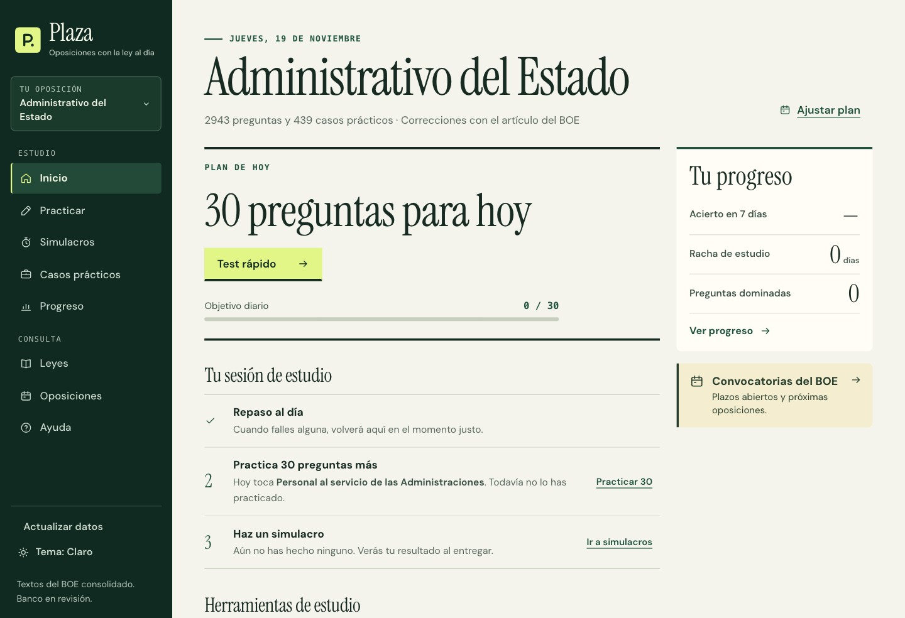

# Plaza · Prepara oposiciones en tu ordenador

Plaza es un proyecto abierto de [Aulafy.net](https://www.aulafy.net/) para practicar oposiciones con **tests, supuestos prácticos y simulacros**. Cada corrección muestra el artículo de la ley que la fundamenta. Funciona sin conexión y tu progreso se guarda en tu propio navegador.

> Herramienta educativa y orientativa, no oficial. Confirma siempre los datos en el BOE y en las bases de tu convocatoria. [Aviso de responsabilidad](#aviso-de-responsabilidad)

## Empieza en tres pasos

1. **[Descarga Plaza](https://github.com/aulafy/oposicion-es/archive/refs/heads/main.zip)** (un archivo ZIP).
2. **Instálala** siguiendo la [guía para macOS, Windows o Linux](docs/INSTALACION.md). ¿Primera vez en GitHub? Copia el [texto preparado para que Codex o Claude te ayuden](docs/INSTALAR-CON-UN-ASISTENTE.md).
3. **Abre Plaza**, elige tu oposición y pulsa **Inicio → Test rápido**.

[Ver las siete pantallas explicadas](docs/PANTALLAS.md) · [Descargar la guía rápida en PDF](docs/Plaza-Guia-rapida.pdf)

## Qué incluye

**Oposiciones del catálogo:** Administrativo y Auxiliar del Estado, Tramitación Procesal y Administrativa, Auxilio Judicial, Administración del Servicio Murciano de Salud, Administración Local y Gestión Administrativa C1 de la Región de Murcia (CARM). Iremos incorporando más conforme se revisen sus temarios y ejercicios.

| Si quieres… | Abre… |
| --- | --- |
| Empezar a estudiar | **Inicio → Test rápido**. Elige antes la oposición que preparas. |
| Preparar un tema o practicar un supuesto | **Practicar** o **Casos prácticos**. |
| Hacer un examen de práctica | **Simulacros**. Consulta qué simulacros ofrece tu perfil. |
| Consultar plazas y plazos | **Oposiciones**. Abre el anuncio oficial para confirmar los datos. |
| Descargar novedades | **Actualizar datos** en el menú (↻ en móvil). |

**Tutor opcional con IA local:** después de corregir una pregunta, **Preguntar** abre un tutor que responde con el artículo de esa pregunta, usando un modelo de [Ollama](https://ollama.com) en tu ordenador. La clave de corrección siempre sale del banco de ejercicios, no de la IA. [Configurar el tutor](docs/TUTOR.md) · [Instalar Ollama](docs/OLLAMA-INSTALACION.md)

**En WordPress:** puedes usar Plaza como portada de un sitio WordPress con el tema incluido. [Instalación en WordPress](docs/WORDPRESS.md)

## Siempre al día

Cada día se revisan las **convocatorias** y los **cambios en las normas del BOE**. Las leyes y las preguntas se publican después de comprobar los cambios que afectan a los ejercicios; si un artículo cambia, las preguntas que dependen de él se retiran hasta revisarlas.

Para recibir las novedades, pulsa **Actualizar datos**. Si hay novedades, termina tu test y vuelve a abrir Plaza: se conservan las preguntas y tu progreso, siempre que uses el mismo navegador, perfil y dirección local. [Cómo se publican las novedades](docs/MANTENIMIENTO.md)

## Documentación

| Guía | Para qué sirve |
| --- | --- |
| [Instalación](docs/INSTALACION.md) | Instalar y abrir Plaza en macOS, Windows o Linux. |
| [Instalar con un asistente](docs/INSTALAR-CON-UN-ASISTENTE.md) | Texto para pegar en Codex o Claude si no sabes usar GitHub. |
| [Pantallas](docs/PANTALLAS.md) | Las siete pantallas de Plaza, explicadas. |
| [Guía rápida (PDF)](docs/Plaza-Guia-rapida.pdf) | Resumen para imprimir o compartir. |
| [Tutor](docs/TUTOR.md) · [Instalar Ollama](docs/OLLAMA-INSTALACION.md) | Configurar el tutor opcional con IA local. |
| [WordPress](docs/WORDPRESS.md) | Usar Plaza como portada de un sitio WordPress. |
| [Ayuda](docs/AYUDA.md) | Solución de problemas frecuentes. |
| [Mantenimiento](docs/MANTENIMIENTO.md) | Cómo se revisan y publican convocatorias, leyes y bancos. |
| [Investigación](docs/INVESTIGACION.md) | El trabajo de Aulafy.net sobre modelos de lenguaje en tareas jurídicas. |
| [Licencias](docs/LICENCIAS.md) | Licencia y procedencia de los materiales. |

## Colabora

¿Has visto un error? Pulsa **Reportar error** en la corrección o escribe a **learntouseai@gmail.com** con el identificador de la pregunta. También puedes abrir una incidencia, proponer una oposición o enviar una solicitud de cambios (*pull request*). [Guía para colaborar](CONTRIBUTING.md)

## Licencia

Plaza se publica bajo licencia **MIT**, incluidos el código y los materiales originales del repositorio. Los textos legales proceden del BOE. [Licencia y procedencia de los materiales](docs/LICENCIAS.md)

## Investigación

Aulafy.net estudia si los cambios dirigidos en los parámetros de un modelo ya entrenado («cirugía de pesos») pueden reducir las afirmaciones sin respaldo en tareas jurídicas, sin depender de buscar fragmentos de documentos en cada consulta (RAG). [Alcance y evaluación](docs/INVESTIGACION.md)

## Aviso de responsabilidad

Plaza es una herramienta educativa y de investigación de carácter orientativo; para asesoramiento jurídico sobre tu caso, consulta a un profesional. Se ofrece tal cual, sin garantías de exactitud, vigencia o cobertura. Las explicaciones de IA y las fechas estimadas pueden contener errores. Para decidir qué estudiar o cuándo presentar una solicitud, consulta las bases y el anuncio oficial. Los textos consolidados del BOE tienen carácter informativo. [Información de la Agencia Estatal BOE](https://www.boe.es/buscar/ayudas/legislacion_actualizada.php)
