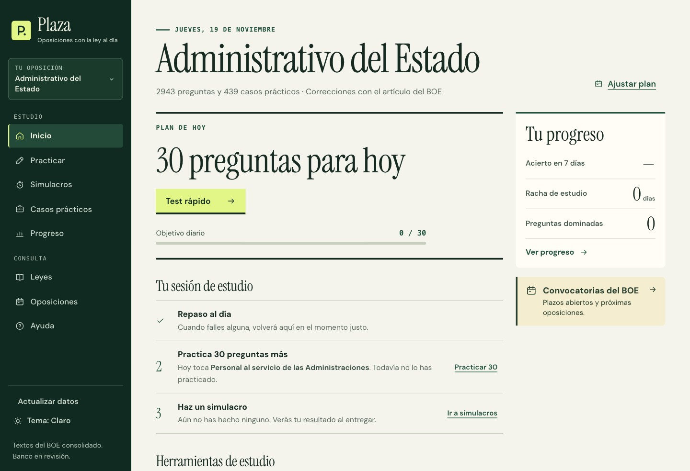
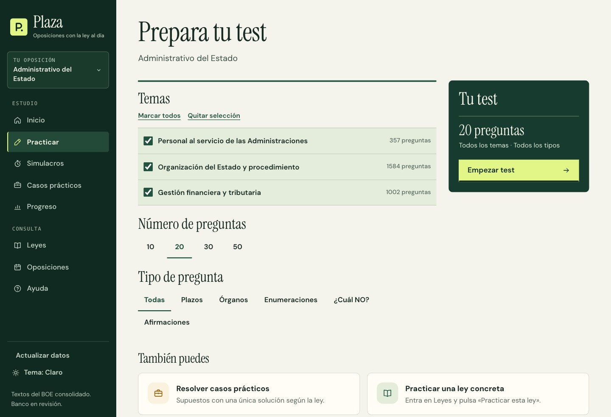
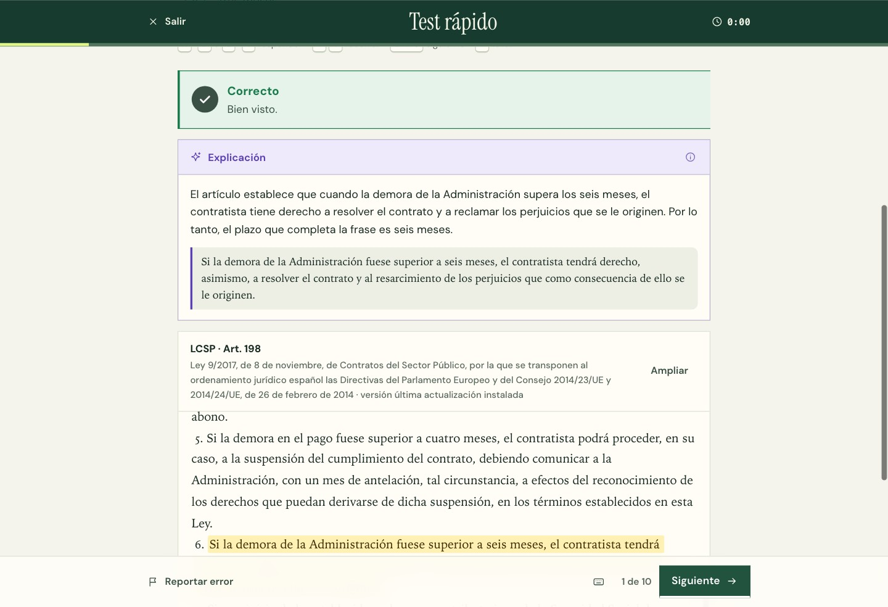
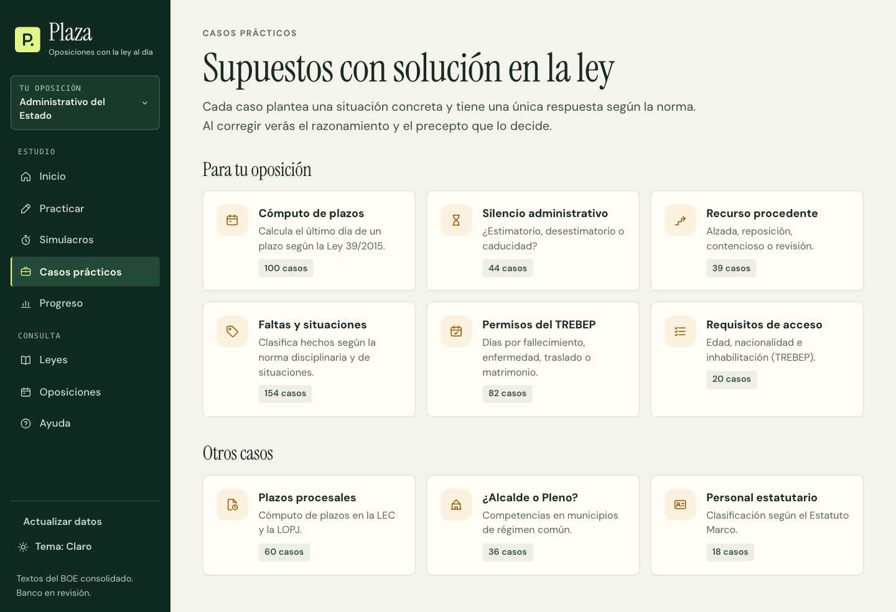
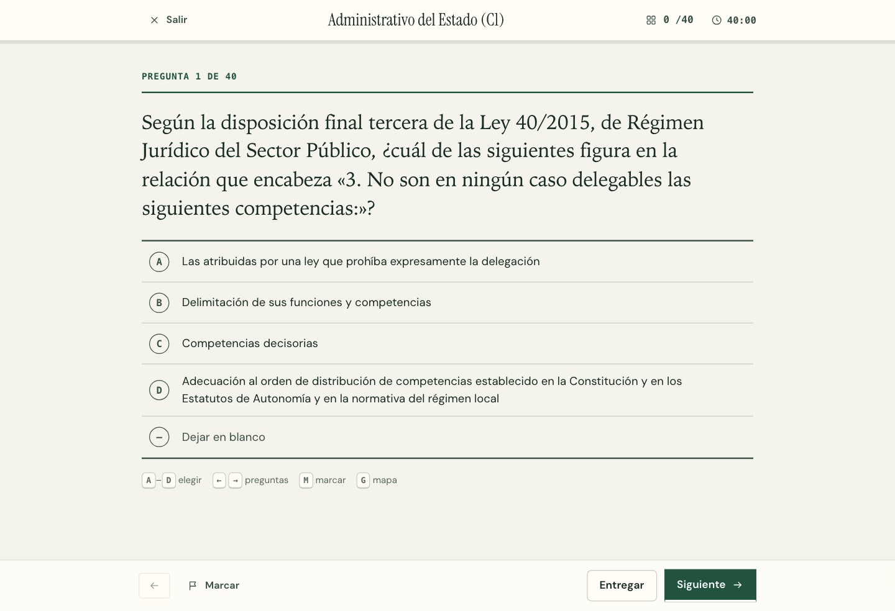
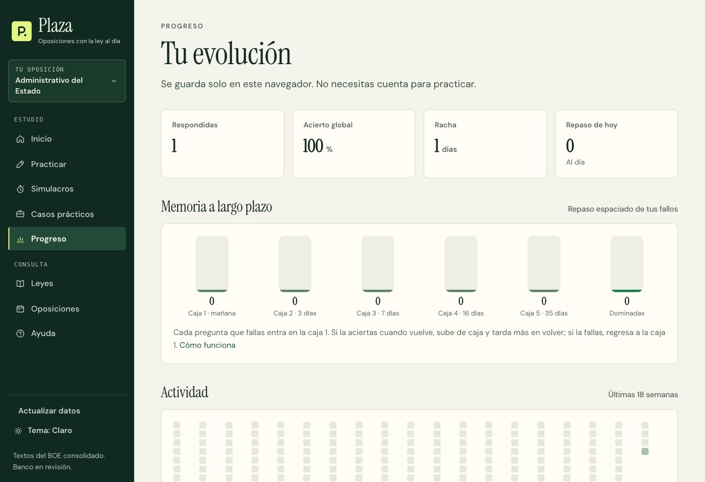
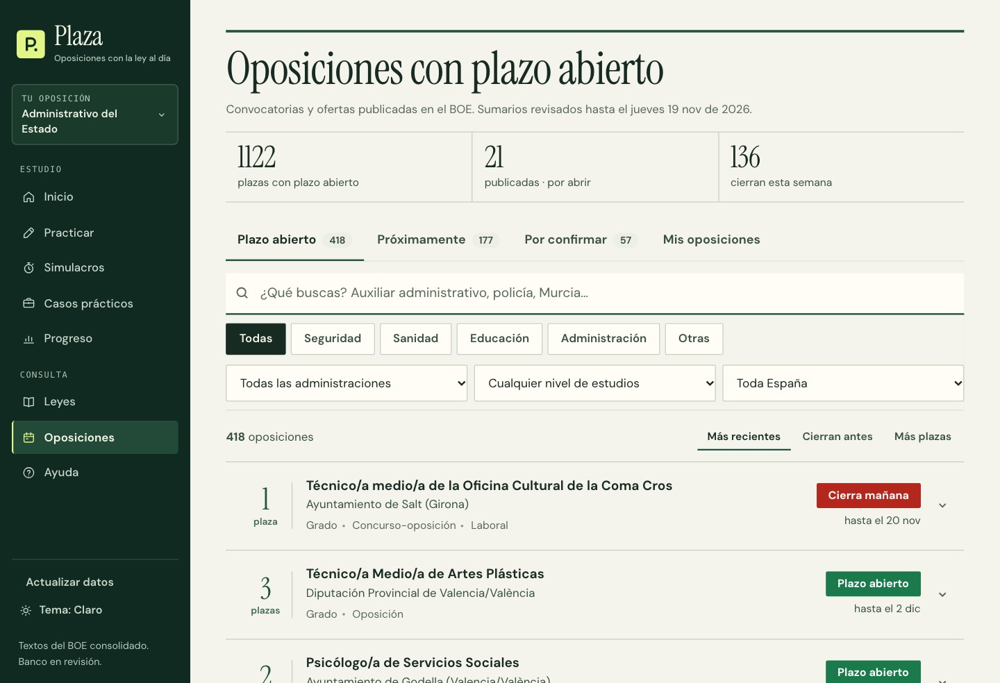

# Plaza por dentro

Recorre las pantallas principales de Plaza. Si prefieres guardarte los pasos, [descarga la guía rápida en PDF](Plaza-Guia-rapida.pdf).

## 1. Inicio

Aquí eliges tu oposición y ves qué puedes practicar hoy. Pulsa **Test rápido** para responder diez preguntas o usa **Ajustar plan** para cambiar tu objetivo diario.

## 2. Practicar

Prepara un test a tu medida. Marca los temas que quieres repasar y elige la cantidad y el tipo de preguntas. Plaza indica cuántas coinciden con tu selección antes de empezar.

## 3. Corrección

Después de responder, verás la opción correcta y el fundamento. Puedes abrir el artículo, usar **Preguntar** si tienes el tutor de Ollama preparado o pulsar **Reportar error** si ves algo que conviene revisar.

## 4. Casos prácticos

Usa la ley en situaciones concretas. Elige, por ejemplo, **Cómputo de plazos** para practicar cómo se calcula el último día de un trámite.

## 5. Simulacro

Practica con cronómetro. Puedes dejar preguntas en blanco, marcar las que quieras revisar y moverte entre ellas. La corrección aparece al entregar.

## 6. Progreso

Consulta tus resultados recientes, tu actividad y lo que tienes pendiente de repasar. Abre siempre Plaza con el mismo navegador y perfil para seguir desde tu historial.

## 7. Oposiciones

Busca convocatorias por puesto u organismo y usa los filtros para acotar la búsqueda. Abre una ficha para consultar los detalles y confirma los plazos en el anuncio oficial.

