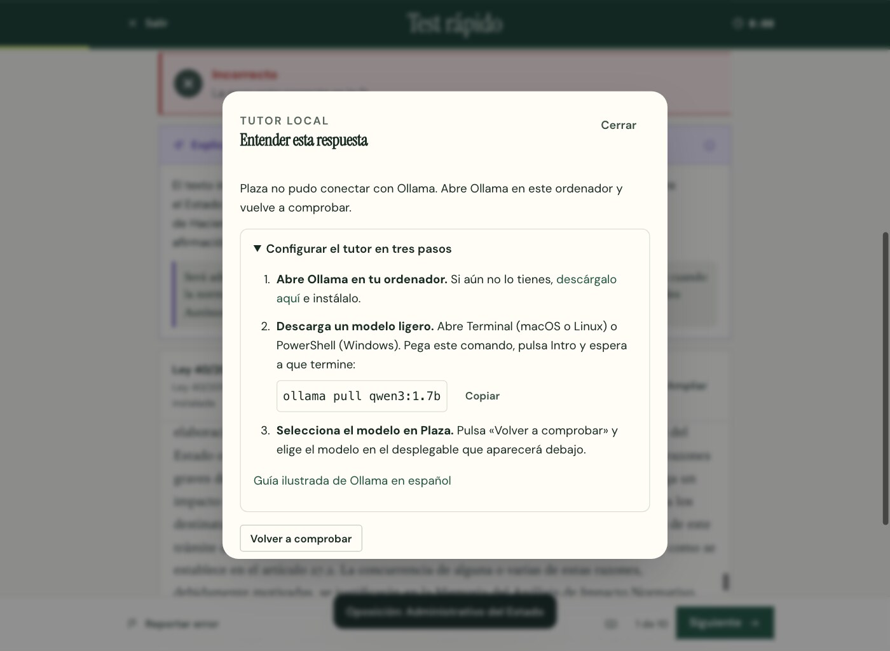
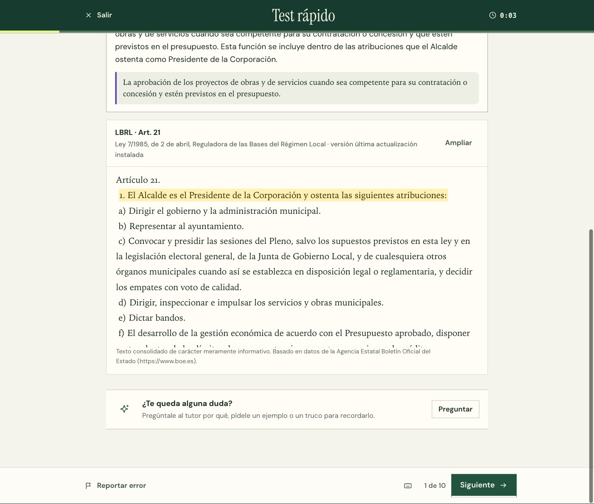
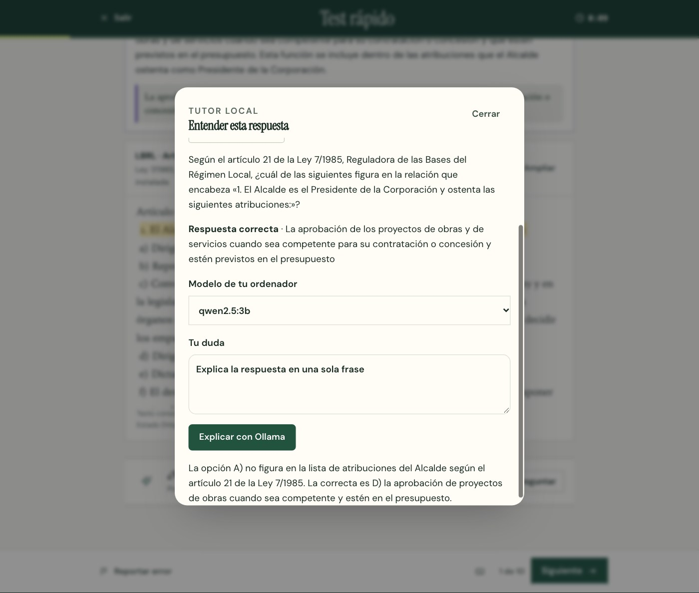

# Configurar el tutor de Plaza con Ollama

El tutor te ayuda a entender por qué una respuesta es correcta. Ollama ejecuta el modelo de IA en tu ordenador. Puedes hacer tests y leer las correcciones desde el primer día. Configura Ollama cuando quieras hacer tus propias preguntas al tutor.

## Configuración paso a paso con capturas

### 1. Instala y abre Ollama

- **macOS.** Descarga la aplicación, muévela a Aplicaciones si el instalador te lo pide y ábrela. Consulta los requisitos de tu versión de macOS. [Guía oficial para macOS](https://docs.ollama.com/macos)
- **Windows.** Descarga y ejecuta el instalador de Ollama. Al terminar, abre Ollama desde el menú Inicio y abre una ventana nueva de PowerShell. [Guía oficial para Windows](https://docs.ollama.com/windows)
- **Linux.** Sigue los pasos del instalador oficial de Ollama. Si el servicio está detenido, ejecuta `ollama serve` y deja esa terminal abierta. Usa otra terminal para descargar el modelo. [Guía oficial para Linux](https://docs.ollama.com/linux)

Para seguir la instalación y descargar tu primer modelo con una explicación en español, consulta la lección de Aulafy.net. [Ollama desde cero](https://www.aulafy.net/cursos/ia-local/ollama-desde-cero) · [Descargar Ollama](https://ollama.com/download) · [Guía oficial de inicio](https://docs.ollama.com/quickstart)

### 2. Descarga un modelo

Abre **Terminal** en macOS o Linux, o **PowerShell** en Windows. Para empezar, copia este comando, pégalo y pulsa Intro. La descarga necesita internet y ocupa aproximadamente 1,4 GB. Si ya tienes un modelo local, puedes usarlo.

```text
ollama pull qwen3:1.7b
```

### 3. Guarda el modelo en Plaza

Abre **Configurar Ollama**, debajo del menú lateral de Plaza. En una pantalla estrecha, usa el icono de engranaje de la barra superior. Pulsa **Volver a comprobar** si acabas de descargar un modelo, elígelo en **Modelo de tu ordenador** y pulsa **Guardar y cerrar**.



### 4. Haz tu primera pregunta

Responde una pregunta del test y pulsa **Preguntar** al final de la corrección. El tutor abre una conversación con el modelo que guardaste.



Puedes elegir una sugerencia para entender un error, pedir un ejemplo o buscar un truco para recordar la respuesta. También puedes escribir tu duda y hacer preguntas de seguimiento. La primera respuesta puede tardar mientras el modelo se carga. Lee la explicación junto al artículo que muestra Plaza.



## Modelos según la memoria del ordenador

Si tienes **8 GB**, empieza con **Qwen3 1.7B**. Con **16 GB**, prueba primero **Qwen2.5 3B**, que hemos usado con el tutor de Plaza en macOS. Descarga un solo modelo para comenzar.

La tabla indica el **espacio en disco** que ocupa cada descarga. La **memoria RAM** necesaria para ejecutar el modelo depende también de las demás aplicaciones abiertas y de la longitud del texto que lea el tutor. En un Mac con Apple Silicon, fíjate en la memoria unificada. Si tu ordenador usa solo el procesador, empieza por un modelo pequeño.

| Equipo orientativo | Comando para descargar | Espacio aproximado |
| --- | --- | --- |
| Portátil de 4–6 GB con poca memoria libre | `ollama pull qwen3:0.6b` | 523 MB |
| Portátil de 6–8 GB, prueba ligera | `ollama pull gemma3:1b` | 806 MB |
| Portátil de 8 GB, punto de partida | `ollama pull qwen3:1.7b` | 1,4 GB |
| PC o Mac de 8–16 GB, cerrando otras aplicaciones | `ollama pull qwen2.5:3b` | 1,9 GB |
| Mac con Apple Silicon o PC de 16 GB | `ollama pull qwen3:4b` | 2,5 GB |
| Equipo de 16 GB con memoria libre | `ollama pull gemma3:4b` | 3,4 GB |
| Mac de 16–24 GB o PC de 24 GB | `ollama pull qwen3:8b` | 5,2 GB |
| Mac o PC de 24–32 GB | `ollama pull gemma3:12b` | 8,2 GB |
| Mac o PC de 32 GB | `ollama pull qwen3:14b` | 9,3 GB |
| Mac de 48 GB o estación de trabajo de 64 GB | `ollama pull gemma3:27b` | 17 GB |

Los modelos más pequeños sirven para empezar y pueden dar explicaciones más limitadas. Si Ollama indica que falta memoria, baja un tamaño. Contrasta la respuesta con el artículo incluso si usas un modelo grande. [Tamaños de Qwen3](https://ollama.com/library/qwen3/tags) · [Ficha de Qwen2.5 3B](https://ollama.com/library/qwen2.5:3b) · [Tamaños de Gemma 3](https://ollama.com/library/gemma3/tags)

## Si el tutor no conecta

- **Plaza no detecta Ollama.** Abre Ollama en el mismo ordenador. En Plaza, entra en **Configurar Ollama** y pulsa **Volver a comprobar**.
- **Ollama está abierto y el selector está vacío.** Ejecuta `ollama list` en Terminal o PowerShell. Si el modelo no aparece, descárgalo y vuelve a comprobar.
- **El equipo se queda sin memoria.** Cierra otras aplicaciones o elige un modelo más pequeño. Puedes cambiarlo en **Configurar Ollama**.
- **Usas Plaza desde WordPress.** Si el navegador pide acceso a la red local, concédelo al sitio de Plaza. Para autorizar el dominio en Ollama, sigue la [guía de WordPress](WORDPRESS.md#tutor-local-con-ollama).

[Ayuda de Plaza](AYUDA.md) · [Solución de problemas en Aulafy.net](https://www.aulafy.net/cursos/ia-local/troubleshooting-ollama)
